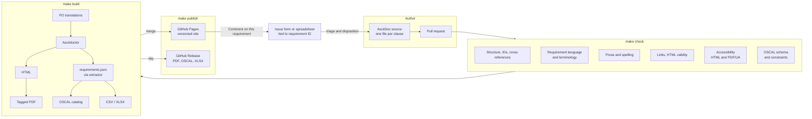

# Standards publishing pipeline

A working demonstration of a technical-standards pipeline: authoring → automated validation → publishing, from one plain-text source.

The sample standard is the *Member Data Stewardship Standard* (MDSS), a small original standard structured like PCI DSS: scope, normative references, terms, three clauses of requirements, tables, an informative annex and a bibliography. Every requirement has a stable ID, a requirement statement, testing procedures and guidance.

- Criteria: [`KeyRequirements.md`](KeyRequirements.md)
- Research, scored matrix and scale tests: [`docs/research/`](docs/research/README.md)
- Decisions: [`docs/decisions/`](docs/decisions/)

## Quick start

You need Docker and Make (both are in the devcontainer). Every command runs inside one pinned toolbox image, so results are the same locally and in CI. The first run builds that image, which takes several minutes.

```sh
make check           # run every validation layer
make build           # HTML, PDF, OSCAL catalog, CSV/XLSX, comment template
make publish         # assemble the versioned site and release artifacts
make check-fixtures  # prove each validator fails on its failure fixture
make check-scale     # prove the pipeline on a generated 400-page standard
make help            # list every target
```

Output goes to `build/`: `build/site/<lang>/` (HTML), `build/dist/` (PDF, OSCAL, spreadsheets), `build/publish/site/` (site as published) and `build/release/` (release artifacts with checksums).

## Workflow



## Writing the standard

The source is AsciiDoc in `src/en/`, one file per clause or annex, assembled by `standard.adoc`. A requirement looks like this:

```asciidoc
[[REQ-4.1.2]]
[.requirement]
==== Removal of access on departure

[.statement]
--
The entity shall disable the user identifiers of a person within one business day of that person leaving the entity.
--

[.testing]
.Testing procedures
[[TP-4.1.2.a]]4.1.2.a:: Examine the leaver procedure to verify that it defines who disables user identifiers.

[.guidance]
.Guidance
****
Accounts that remain active after a person leaves are a common route for unauthorised access.
****
```

Rules of the convention, all enforced by `make check`:

- The ID is `REQ-` plus the clause number that Asciidoctor generates, so moving a requirement without renumbering its ID fails the build.
- Testing procedures are lettered `a`, `b`, `c` in order and start with *Examine*, *Interview* or *Observe*.
- The statement uses "shall". Guidance, notes and anything marked `[.informative]` take no normative keywords.
- Annexes and the bibliography declare `[.informative]` or `[.normative]`.

In VS Code, type `req`, `tp` or `term` in an `.adoc` file for a snippet of each block. The AsciiDoc extension gives a live preview.

## Validation layers

Each layer is its own target and has at least one failure fixture in `tests/fixtures/`.

| Target | Checks | Tool |
|---|---|---|
| `check-source` | AsciiDoc syntax, includes, internal cross-references, duplicate IDs | Asciidoctor (any warning fails) |
| `check-structure` | Required sections, requirement IDs match numbering, required parts, procedure lettering | JSON Schema + `tools/check_requirements.py` |
| `check-language` | Normative keywords only in normative text; every statement uses "shall" | `tools/check_requirements.py` |
| `check-terms` | Defined terms used as defined | Vale (`styles/MDSS/Terms.yml`) |
| `check-prose` | Style rules and spelling | Vale, cspell |
| `check-links` | External links and anchors resolve | lychee |
| `check-html` | HTML is valid | Nu Html Checker |
| `check-pdf` | PDFs exist, are tagged, have a title and language | pypdf |
| `check-a11y-html` | WCAG 2.0–2.2 A/AA automated rules | axe-core |
| `check-a11y-pdf` | PDF/UA-1 | veraPDF |
| `check-oscal` | Catalog validates against the NIST schema, then OSCAL constraints | check-jsonschema, oscal-cli |
| `check-exports` | CSV/XLSX row counts match the standard | `tools/export_grc.py --verify` |

Messages point at the source file and line, for example:

```
src/en/04-access-management.adoc:33: [ID-NUMBER] requirement ID 'REQ-4.1.7' does not match its clause number '4.1.1' (expected 'REQ-4.1.1')
```

**Limits.** Passing the automated accessibility checks is not the same as conformance. axe-core and veraPDF cover the machine-checkable part of WCAG 2.2 AA and PDF/UA; reading order, alternative-text quality and keyboard use still need a human review.

## Outputs

| Output | File | Notes |
|---|---|---|
| HTML | `build/site/<lang>/index.html` | Self-contained page per language |
| PDF | `build/dist/mdss-<version>-<lang>.pdf` | Tagged, PDF/UA-1, built from the HTML by WeasyPrint |
| OSCAL catalog | `build/dist/mdss-<version>-catalog.json` | OSCAL 1.2.1; requirement → control, testing procedure → `assessment-method` part, guidance → `guidance` part |
| GRC import | `mdss-<version>-requirements.csv`, `-testing-procedures.csv`, `-requirements.xlsx` | One row per requirement; one row per testing procedure |
| Comment template | `mdss-<version>-comment-template.xlsx` | For reviewers without a GitHub account |

Everything except HTML and PDF is generated from `build/requirements.json`, which `tools/extract_requirements.rb` produces from the parsed document.

## Translation

English is the master. Translations are PO files in `l10n/po/`, handled by po4a, so translators never touch markup and changed English text is flagged for re-translation.

```sh
make l10n-update     # refresh l10n/po/*.po after the English source changes
make build           # builds en, es and ja
```

The demo ships a partly translated Spanish edition and a Japanese smoke test. Both are demonstration translations and have not been reviewed by a translator; untranslated text appears in English. Requirement IDs are identical in every language. Right-to-left output is supported by the stylesheet design but is not demonstrated.

## Feedback from reviewers

Comments are separate from author changes (which are pull requests), and each one is tied to a requirement or clause ID.

- **With a GitHub account:** every requirement in the HTML has a "Comment on requirement" link that opens an issue form with the ID filled in. A workflow checks the ID and labels the issue `id-verified` or `needs-valid-id`.
- **Without one:** reviewers fill in the spreadsheet template and send it to a maintainer, who saves it in `inbox/` (ignored by Git, since it can hold personal details) and runs `make feedback-import FILE=inbox/comments.xlsx` (add `DRY_RUN=1` to check it first). Each row becomes an issue.
- **Disposition:** `make feedback-export` writes all comments to `build/feedback/` as CSV and XLSX, with the `disposition:*` label of each.

Run `make feedback-setup` once per repository to create the labels. The feedback targets use your `gh` login.

## Publishing and releases

GitHub Actions (`.github/workflows/ci.yml`) calls the same `make` targets:

| Event | What happens |
|---|---|
| Pull request | `make check`, `make check-fixtures`, `make check-scale` |
| Push to `main` | The same, then the site is published under `/draft/` |
| Tag `vX.Y.Z` | The same, then the site is published under `/vX.Y.Z/` and `/latest/`, and a GitHub Release is created with the PDFs, OSCAL catalog, spreadsheets, site archive and checksums |

The tag must match the `VERSION` file. Earlier versions stay on the site; the built site is kept on the `gh-pages` branch. Provenance attestation of release artifacts runs only when the repository is public.

To release: update `VERSION`, merge, then `git tag v$(cat VERSION) && git push --tags`.

## Reproducibility

- `tools/Dockerfile` pins every tool: base images by digest, binaries by version (and checksum where published), Python and Node packages by exact version with a lockfile.
- The image tag is a hash of those files, so changing a pin rebuilds the image.
- GitHub Actions are pinned by commit SHA; Dependabot proposes updates.

## Repository layout

| Path | Contents |
|---|---|
| `src/en/` | The standard (AsciiDoc) |
| `l10n/` | po4a configuration and PO files |
| `theme/standard.css` | Stylesheet for HTML and PDF |
| `styles/MDSS/`, `.vale.ini`, `cspell.json` | Prose, terminology and spelling rules |
| `tools/` | Toolbox image, extractor, rule script, OSCAL and spreadsheet exporters, feedback and site tools |
| `tests/fixtures/` | Failure fixtures, one directory per defect |
| `.github/` | Workflows, issue form, Dependabot |
| `docs/` | Research and decision records |
