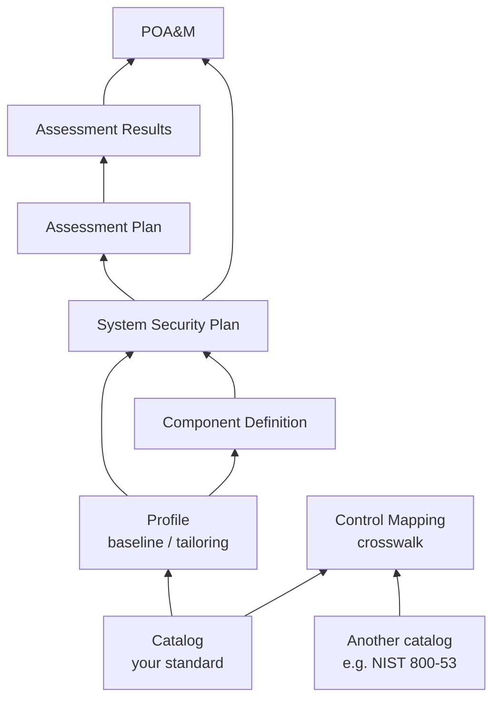
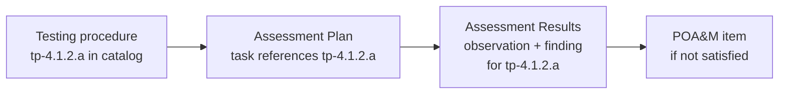

# OSCAL: a practical guide for first-time adopters

A guided tour of the Open Security Controls Assessment Language (OSCAL), written for an organization that publishes or adopts a requirements standard and is new to OSCAL. It starts at the big picture and narrows to the parts that matter most for authenticity, scoping, mapping and GRC consumption.

> **Checked:** 2026-11-17 against OSCAL **v1.2.3** (released 2026-08-07) and its Metaschema source. Section 12 marks claims that come from secondary sources. Re-check versions before relying on them.

## Contents

1. [OSCAL in one page](#1-oscal-in-one-page)
2. [The three layers and eight models](#2-the-three-layers-and-eight-models)
3. [Which models matter to whom](#3-which-models-matter-to-whom)
4. [Building blocks shared by every model](#4-building-blocks-shared-by-every-model)
5. [Catalogs: the standard itself](#5-catalogs-the-standard-itself)
6. [Profiles: selecting and tailoring](#6-profiles-selecting-and-tailoring)
7. [Control mappings: official crosswalks](#7-control-mappings-official-crosswalks)
8. [Implementation and assessment layers in brief](#8-implementation-and-assessment-layers-in-brief)
9. [Extending OSCAL with your own properties](#9-extending-oscal-with-your-own-properties)
10. [Identity, versioning and integrity](#10-identity-versioning-and-integrity)
11. [Validation](#11-validation)
12. [The ecosystem today](#12-the-ecosystem-today)
13. [A first-time adoption roadmap](#13-a-first-time-adoption-roadmap)
14. [Common pitfalls](#14-common-pitfalls)
15. [Glossary](#15-glossary)
16. [Sources](#16-sources)

---

## 1. OSCAL in one page

**What it is.** A set of open, machine-readable data models for security and compliance information: control catalogs, baselines, system security plans, assessment plans and results, and remediation tracking. Each model is available in **XML, JSON and YAML**, and the three are interchangeable.

**Who runs it.** NIST hosts and releases OSCAL (`usnistgov/OSCAL` on GitHub). The OSCAL Foundation co-leads model development with NIST.

**Why it exists.** Compliance has long lived in Word and Excel documents that are retyped at every step: by GRC vendors, system owners and assessors. OSCAL lets every party exchange the *same* structured data, with references between documents instead of copies.

**How it's defined.** Every model is written in **Metaschema**, a NIST modeling language. The XML Schema, JSON Schema and reference docs are all generated from it. Metaschema also carries **constraints**, rules that a plain schema can't express (e.g. "a control must have a statement unless it's withdrawn"). This matters for validation; see [section 11](#11-validation).

**What OSCAL is *not*:**

| Not this | What that means for you |
|---|---|
| A standard's content | OSCAL is the container. NIST 800-53, PCI DSS or your standard is the content. |
| A GRC tool | Tools *import or export* OSCAL. Support varies widely ([section 12](#12-the-ecosystem-today)). |
| A signing or integrity mechanism | OSCAL can carry hashes, but has no built-in digital signature. You add that yourself ([section 10](#10-identity-versioning-and-integrity)). |
| A presentation format | There's no layout. HTML and PDF are produced separately from the same source. |

---

## 2. The three layers and eight models

OSCAL is a stack. "Each lower layer in the stack provides information structures that are referenced and used by each higher layer," and "the catalog model is the basis for all other OSCAL models" (NIST).

| Layer | Model | One-line purpose |
|---|---|---|
| **Control** | **Catalog** | The requirements themselves: an organized set of controls. |
| | **Profile** | A selection and tailoring of controls from one or more catalogs, i.e. a baseline. |
| | **Control Mapping** *(new in 1.2.0)* | Declares how controls in one framework relate to controls in another. |
| **Implementation** | **Component Definition** | How a product or service satisfies controls, written once and reused. |
| | **System Security Plan (SSP)** | How a specific system implements a baseline. |
| **Assessment** | **Assessment Plan (AP)** | What will be assessed, how, when and by whom. |
| | **Assessment Results (AR)** | What the assessor observed and found. |
| | **Plan of Action and Milestones (POA&M)** | Findings still open and the plan to fix them. |

How they reference each other:



Each arrow is a **reference by URL and ID**, not a copy. An SSP doesn't repeat your requirement text; it points at your control ID in your catalog through a profile.

---

## 3. Which models matter to whom

| Role | Produces | Consumes |
|---|---|---|
| **Standards publisher** (you, if you publish a standard) | Catalog; optionally profiles per audience and official mappings | — |
| **Adopting organization** (implementing the standard) | Profile (its tailoring), SSP, POA&M | Your catalog, profiles, mappings |
| **Product vendor** | Component Definition | Your catalog or profile |
| **Assessor or QSA-equivalent** | Assessment Plan, Assessment Results | Catalog, profile, SSP |
| **GRC tool vendor** | Imports all of the above where supported | Your catalog (or, more often today, your spreadsheet) |

**If you publish a standard:** concentrate on sections 4–7, 9 and 10. Catalog quality, stable IDs and integrity are your product.

**If you're adopting OSCAL internally:** start with profiles and SSPs, then the assessment layer.

---

## 4. Building blocks shared by every model

Every OSCAL document reuses the same handful of structures. Learn these once.

### 4.1 `metadata`

Every document has one. Key fields:

| Field | Meaning |
|---|---|
| `title` | Human title |
| `published` | When this version was first published |
| `last-modified` | When this document instance was last changed |
| `version` | **Your** version of the content (e.g. `4.0.1`) |
| `oscal-version` | The OSCAL model version the file conforms to (e.g. `1.2.1`) |
| `revisions` | History of earlier versions |
| `document-ids` | Persistent identifiers with a `scheme` (e.g. a DOI or your own URN). The stable name of the publication across versions. |
| `roles`, `parties`, `responsible-parties` | Who is involved (publisher, author, contact) and in what role |
| `props`, `links` | Extra metadata and related resources (e.g. the canonical URL) |

### 4.2 `back-matter`

A list of `resource` entries: citations, attachments and external documents. Other parts of the document link to a resource with `href="#<resource-uuid>"`. A resource can carry `rlinks`, each with one or more **`hash`** values (SHA-224/256/384/512 or SHA3 variants). That's how OSCAL pins an exact external file ([section 10](#10-identity-versioning-and-integrity)).

### 4.3 `props` — name/value metadata

```json
{ "name": "label", "value": "4.1.2" }
```

Optional fields include `ns` (namespace), `class` (sub-type), `group`, `uuid` and `remarks`. OSCAL defines some names, and you can add your own in your namespace ([section 9](#9-extending-oscal-with-your-own-properties)).

### 4.4 `links` — typed references

```json
{ "href": "#req-4.1.1", "rel": "related" }
```

Control links have defined `rel` values such as `reference`, `related`, `required`, `incorporated-into` and `moved-to`. Other values are allowed.

### 4.5 `parts` — named prose blocks

Text lives in `parts`, each with a `name` (`statement`, `guidance`, `assessment-method` and others). Parts nest, so a statement can contain `item` sub-parts.

### 4.6 `params` — fill-in-the-blank values

A parameter is a placeholder inside requirement text, such as "within {{ insert: param, mdss-4.1.2_prm_1 }}". The publisher can set a default or a choice list, and profiles can set or constrain the value. NIST 800-53 uses these for "organization-defined parameters".

### 4.7 Two kinds of identifier

| | `uuid` | `id` |
|---|---|---|
| Example | `3c9a…-…` | `req-4.1.2` |
| Who it's for | Machines | Humans and cross-references |
| Uniqueness | Globally unique | Unique within the document |
| Lifetime | Depends on the object (see [section 10](#10-identity-versioning-and-integrity)) | Should change only "if the underlying identified subject has changed in a significant way" |

Control and group IDs are what everyone downstream will reference: profiles, SSPs, assessment results and spreadsheets. **Treat them as permanent.**

---

## 5. Catalogs: the standard itself

### 5.1 Shape

```
catalog
├── uuid
├── metadata
├── params            (catalog-wide, optional)
├── groups            (clauses / sections; can nest)
│   └── controls      (requirements; can nest as sub-controls)
│       ├── id, class, title
│       ├── params, props, links
│       ├── parts     (statement, guidance, assessment-method, …)
│       └── controls  (control enhancements / sub-requirements)
└── back-matter
```

### 5.2 Mapping a PCI-style requirement

A requirement with an ID, statement, testing procedures and guidance maps cleanly:

| Standard element | OSCAL |
|---|---|
| Clause or section | `group` (with a `label` prop for the displayed number) |
| Requirement | `control` with a stable `id` and `title` |
| Displayed number | `prop` `label` (e.g. `4.1.2`); `sort-id` for ordering |
| Requirement text | `part` named `statement` |
| Testing procedures | `part` named `assessment-method`, one child `item` part per procedure, each with its own ID |
| Guidance | `part` named `guidance` |
| Fill-in values ("within one business day") | `param`, inserted into the statement |
| Related requirements | `links` with `rel="related"` |

Example (abbreviated; the repo's generator is `tools/build_oscal.py`):

```json
{
  "id": "req-4.1.2",
  "class": "requirement",
  "title": "Removal of access on departure",
  "props": [{ "name": "label", "value": "4.1.2" }],
  "parts": [
    { "id": "req-4.1.2_smt", "name": "statement",
      "prose": "The entity shall disable the user identifiers of a person within one business day of that person leaving the entity." },
    { "id": "req-4.1.2_asm", "name": "assessment-method",
      "parts": [
        { "id": "tp-4.1.2.a", "name": "item",
          "prose": "Examine the leaver procedure to verify that it defines who disables user identifiers." }
      ] },
    { "id": "req-4.1.2_gdn", "name": "guidance",
      "prose": "Delays in removing access are a common route for misuse…" }
  ]
}
```

**Testing procedures need their own stable IDs** (`tp-4.1.2.a`). That's what lets an Assessment Plan or Results file say "procedure 4.1.2.a: satisfied", and lets a GRC tool track evidence per procedure.

### 5.3 Defined part names

In NIST's namespace, control parts are restricted to a defined list: `overview`, `statement`, `guidance`, `example`, `assessment-method`, `item`, `assessment-objective`, `assessment-objects`. Older names such as `objective` are deprecated. Assessment methods can carry a `method` prop: `EXAMINE`, `INTERVIEW` or `TEST`.

### 5.4 Control lifecycle: the `status` prop

OSCAL has a built-in way to say a requirement has changed or been retired, without deleting its ID:

| `status` value | Use |
|---|---|
| `withdrawn` | No longer used (pair with `incorporated-into` or `moved-to` links) |
| `deprecated` | Will be withdrawn |
| `superseded` | Replaced (pair with a `superseded-by` link) |
| `modified` | Changed from the prior version |
| `conditional` | Only applies under conditions described in `remarks` |
| `experimental` | Proposed, not yet required. Useful for future-dated requirements. |
| `reserved` | A placeholder for a future control |

A withdrawn control may omit its statement. All other controls must have one; that rule is a Metaschema constraint.

---

## 6. Profiles: selecting and tailoring

A **profile** says "start from these catalogs, take these controls, change these things." It never copies the catalog; it references it.

```
profile
├── imports     → href to a catalog or another profile
│   ├── include-all  |  include-controls (with-ids, matching pattern)
│   └── exclude-controls
├── merge       → how the result is structured (flat, as-is, custom)
├── modify
│   ├── set-parameters   (set or constrain param values)
│   └── alters           (add or remove props, parts and links on specific controls)
└── back-matter
```

**Profile resolution** runs the profile and produces a **resolved profile catalog**: a normal catalog with only the selected, tailored controls. It records `source-profile` and `resolution-tool` links back to where it came from. Most tools and SSPs work from the resolved catalog.

**Uses for a standards publisher:**

- **Audience subsets.** Publish an official profile per audience, such as "service providers" or "small merchants", so adopters don't each build their own.
- **Transition baselines.** For example, a "requirements effective now" profile and a "future-dated requirements" profile.

**Uses for an adopting organization:**

- Record its own scoping and parameter values (e.g. setting "one business day" to "end of the same day") without editing your catalog.

> **Limitation:** profiles select controls by **ID or ID pattern only**, not by prop value. A prop like `applies-to=service-provider` doesn't by itself let a profile select "all service-provider controls". Publish pre-built profiles that list the IDs, or rely on tools that filter on props.

**Tailoring vs. tampering.** Changing requirements through a profile is legitimate and traceable: the original catalog is untouched and referenced. Editing a copy of the catalog is not. Make this distinction explicit in your usage terms.

---

## 7. Control mappings: official crosswalks

New in **OSCAL 1.2.0** (and the newest model). A **mapping collection** states, in machine-readable form, how controls in a source catalog relate to controls in a target catalog, e.g. "MDSS 4.1.2 → NIST 800-53 AC-2".

```
mapping-collection
├── metadata
├── provenance   (method, matching-rationale, status, description, confidence, coverage)
└── mappings
    └── mapping  (source-resource, target-resource)
        └── maps
            └── map (relationship, sources[], targets[], rationale, confidence, coverage)
```

**Relationship values** (NIST namespace):

| Relationship | Meaning |
|---|---|
| `equal-to` | Same requirement; wording differences don't change meaning |
| `equivalent-to` | Same effective meaning, different words |
| `subset-of` | Target contains everything in source, and more |
| `superset-of` | Source contains everything in target, and more |
| `intersects-with` | Partial overlap |
| `no-relationship` | Explicitly assessed as unrelated |

Mappings can also record **gap summaries** (controls left unmapped), a **confidence score** and the **method** used. That makes mappings defensible rather than one person's opinion.

**Why this matters.** GRC vendors write their own crosswalks today ("test once, comply many"). Publishing official mappings means your view of equivalence travels with your standard.

---

## 8. Implementation and assessment layers in brief

You don't need these on day one as a publisher, but your catalog design determines how well they work.

| Model | What it holds | What it needs from your catalog |
|---|---|---|
| **Component Definition** | A product's or service's built-in control implementations ("our IAM product satisfies 4.1.2 like this") | Stable control IDs; statement `item` IDs if vendors answer per sub-item |
| **SSP** | A system's description, roles, components and per-control implementation statements | Stable control IDs, params |
| **Assessment Plan** | Scope, methods, assessors, schedule and tasks | Testing-procedure IDs, `method` props |
| **Assessment Results** | Observations, evidence, findings and risks, each tied to a control or objective | Testing-procedure IDs |
| **POA&M** | Open findings, milestones and deviations | Control IDs |

The chain that matters for "testing against the standard":



---

## 9. Extending OSCAL with your own properties

OSCAL is designed to be extended through **props in your own namespace**, rather than by changing the model.

### 9.1 The rules

1. **Check for an existing name first.** NIST asks authors to use a defined name where one fits, and to request new ones through a GitHub issue.
2. **Use your own `ns`.** A prop with no `ns` falls in the default namespace, `http://csrc.nist.gov/ns/oscal`. There, control prop names are a **closed list** (`label`, `sort-id`, `alt-identifier`, `status` and others), so an invented name fails constraint validation. With your own namespace, any name is allowed.
3. **Base the namespace on a domain you control**, e.g. `https://standards.example.org/ns/oscal`. It must be a URI. It doesn't need to resolve, but a page there documenting your props helps adopters.
4. **Names are tokens** (no spaces). **Repeat a prop for multiple values**; don't comma-separate.
5. **Use `class`** to sub-type when the same name needs variants.
6. **Define allowed values.** NIST calls this "a critical part of defining a new property name."

### 9.2 Example: `applies-to`

```json
"props": [
  { "name": "applies-to", "ns": "https://standards.example.org/ns/oscal", "value": "service-provider" },
  { "name": "applies-to", "ns": "https://standards.example.org/ns/oscal", "value": "merchant" }
]
```

### 9.3 Enforcing your vocabulary

The NIST schemas accept any value in your namespace. To enforce yours (e.g. `applies-to` must be `merchant`, `service-provider` or `all`, and every control needs at least one), write a **Metaschema external constraint file** and load it into oscal-cli alongside the standard constraints. Publish that file with the catalog so adopters can validate too.

### 9.4 Good candidates for custom props

| Prop | Purpose |
|---|---|
| `applies-to` | Audience or entity-type scoping |
| `effective-date` | Future-dated requirements (alternatively the built-in `status=experimental`) |
| `requirement-type` | E.g. defined vs. customized approach |
| `assessment-frequency` | How often the requirement must be tested |
| `text-fingerprint` | A hash of the normative text, for integrity ([section 10](#10-identity-versioning-and-integrity)) |

### 9.5 Caveats

- **Most GRC tools ignore unknown props.** Repeat important ones as columns in your CSV/XLSX export.
- **Props are metadata, not requirements.** If a condition changes what an entity must do, put it in the statement text or a param.

---

## 10. Identity, versioning and integrity

This is where first-time adopters most often go wrong, and where the authenticity questions get answered.

### 10.1 Which identifier is stable?

The Metaschema assigns each identifier a **persistence rule**:

| Identifier | Persistence | Practical meaning |
|---|---|---|
| Document `uuid` (catalog, profile, …) | **change-on-write** | **A new UUID every time the document is changed.** It identifies this exact instance, not "the standard". |
| Control and group `id` | per-subject | Stays the same across versions while the requirement means the same thing |
| Role and party `uuid` | per-subject | Same organization means the same UUID across versions |
| `metadata/document-ids` (with `scheme`) | You decide; intended to be persistent | **The stable name of the publication across versions**, e.g. `urn:example:mdss` |
| `metadata/version` | Your versioning scheme | Which edition this is |

So: identify **the standard** by `document-id`, **the edition** by `version`, and **this exact file** by `uuid` plus a hash. (The repo's generator derives the UUID from title, version and language, so each edition and translation gets its own UUID.)

### 10.2 Change history

- `metadata/revisions` lists prior versions with dates and remarks.
- `status` props and `moved-to`/`incorporated-into` links on individual controls record what happened to each requirement ([section 5.4](#54-control-lifecycle-the-status-prop)).
- `last-modified` should be the real time of change. It's what tools use to detect a newer copy.

### 10.3 Integrity: what OSCAL gives you and what it doesn't

| Need | OSCAL-native? | How |
|---|---|---|
| Pin an exact external file | **Yes** | `back-matter/resource/rlink/hash`. Profiles importing your catalog can reference it through a hashed resource. |
| Show where a derived catalog came from | **Yes** | Resolved profile catalogs carry `source-profile` and `resolution-tool` links |
| Point to the authoritative copy | **Yes** | A `metadata/link` to the canonical URL; `document-ids` |
| Prove who published a file and that it's unchanged | **No** | Detached signatures: Sigstore/cosign, GitHub artifact attestations, GPG; or embedded XML-DSig (XML) or JWS (JSON) |
| Detect a changed requirement after GRC import | **No** | A per-control text fingerprint (custom prop plus spreadsheet column) computed over canonicalized text |

**Why per-control fingerprints matter.** GRC tools re-format and re-import content, which breaks file-level hashes and strips embedded signatures. A fingerprint of each requirement's normative text survives as a value. Hash a canonical form (RFC 8785 for JSON, XML C14N for XML, or normalized plain text) so that reformatting alone doesn't cause false alarms.

A recommended minimum for a publisher:

1. A stable `document-id`, a canonical URL link and an honest `version` and `last-modified` in metadata.
2. A signed release manifest listing the hash of every artifact (OSCAL, PDF, XLSX), published separately from the files.
3. Per-control text fingerprints in OSCAL and the spreadsheet.
4. A conformance-claim rule in the standard: claims must cite version and catalog hash.

---

## 11. Validation

OSCAL validation has three levels, and many tools stop at the second.

| Level | Checks | Tools |
|---|---|---|
| 1. Well-formed | Valid JSON, XML or YAML syntax | Any parser |
| 2. Schema-valid | Structure, required fields, data types, against NIST's generated JSON Schema or XSD | `check-jsonschema`, `xmllint`, go-oscal |
| 3. Constraint-valid | Metaschema rules: allowed values (e.g. control prop names), uniqueness, cross-references, "statement required unless withdrawn" | **oscal-cli** (metaschema-framework fork), the main tool that runs these |

Add your own level 4: **external constraints** for your namespace ([section 9.3](#93-enforcing-your-vocabulary)).

In this repo, `make check-oscal` runs levels 2 and 3 (`check-jsonschema` then `oscal-cli validate`).

**Tip:** pin the OSCAL schema version you validate against, and set `oscal-version` in metadata to match what your validator supports. Mismatches are a common first-week failure.

---

## 12. The ecosystem today

### 12.1 Versions and tooling (checked 2026-11-16/17)

| Item | Status |
|---|---|
| OSCAL | v1.2.3 (2026-08-07). 1.2.0 added Control Mapping; 1.2.1–1.2.3 are patch releases with no model changes. |
| oscal-cli (metaschema-framework) | 3.2.0 (2026-05-15), ships 1.2.1 bindings. The original `usnistgov/oscal-cli` is stale (last release 2024). |
| compliance-trestle (CNCF sandbox) | 5.2.1 (2026-11-10). Python; good for SSP and component workflows, oriented toward 800-53. |
| go-oscal | 0.7.2 (2026-10-20). Single binary, schema-level checks only. |
| Avoid | Lula (dropped OSCAL), oscal-pydantic (dead), npm `oscal` (stale) |

See [`docs/research/oscal-grc.md`](research/oscal-grc.md) for details and sources.

### 12.2 Published catalogs

- **NIST SP 800-53** catalog and baselines: the reference example.
- **FedRAMP** baselines (profiles).
- **CIS Controls**: an OSCAL repo exists, marked work in progress.
- **PCI DSS**: no official OSCAL. GRC tools carry vendor-built or licensed versions.

### 12.3 FedRAMP: the main adoption driver

*Secondary sources plus FedRAMP notice NTC-0009; confirm against fedramp.gov before relying on dates.*

- FedRAMP's **Consolidated Rules for 2026 (CR26)** were finalized in late June 2026. FedRAMP publishes its own requirements as machine-readable data and treats that version as authoritative.
- **RFC-0024 / NTC-0009** require **comprehensive machine-readable authorization data for Class D (High)**. Classes A–C move from DOCX/XLSX to semi-structured text, with some machine-readable data. Human-readable versions must be *generated from* the machine-readable source.
- Dates in NTC-0009 (may be brought forward by CR26, not moved later): new Class D submissions by **2027-05-01**; existing services at their next annual assessment, by **2027-11-01**.
- FedRAMP won't build tools itself; it expects industry and the OSCAL Foundation to provide them.

**What this means outside federal work:** FedRAMP's "machine-readable source is authoritative, documents are generated" model is the direction of travel, and it's the model this repo demonstrates.

### 12.4 GRC tool reality

- **OSCAL-native import** is strongest in federal-leaning tools (ServiceNow's CAM workspace, RegScale).
- **Mainstream GRC tools** (Hyperproof, Drata, Vanta, eramba, CISO Assistant and others) mostly import **CSV/XLSX** using their own column layouts.
- Most tools ship **their own content libraries**, often licensed from aggregators such as the Unified Compliance Framework, so many users see a vendor's copy of a standard rather than the publisher's.

**Practical consequence:** publish OSCAL *and* a well-structured spreadsheet from the same source, and carry IDs, version and fingerprints in both.

---

## 13. A first-time adoption roadmap

### Phase 0: Decide your role (week 1)

- Publisher, adopter, or both? This decides which models you touch first ([section 3](#3-which-models-matter-to-whom)).
- Choose JSON or XML as your working format. JSON is the more common choice for new tooling.

### Phase 1: Identity and conventions (before any content)

- [ ] Choose the control **ID scheme** and commit to never reusing or renumbering IDs.
- [ ] Give testing procedures and statement items their own IDs.
- [ ] Register a **namespace URI** for custom props and document it.
- [ ] Define the `document-id` scheme and versioning policy.
- [ ] Decide which custom props you need, with allowed values.

### Phase 2: Catalog

- [ ] Generate the catalog from your authoring source. Don't hand-edit JSON.
- [ ] Validate at all three levels plus your own constraints in CI.
- [ ] Use `status` and links for changed or withdrawn requirements.

### Phase 3: Distribution and integrity

- [ ] Publish the catalog, the spreadsheet and a signed manifest with each release.
- [ ] Add canonical links, `document-ids` and per-control fingerprints.
- [ ] Publish your constraint file and namespace documentation.

### Phase 4: Profiles and mappings

- [ ] Official profiles per audience (instead of relying on props for selection).
- [ ] Official mappings to major frameworks (NIST 800-53, ISO 27001, NIST CSF) with provenance and confidence.

### Phase 5: Downstream (adopters and assessors)

- [ ] SSP and component definitions that reference your catalog.
- [ ] Assessment Plan and Results referencing testing-procedure IDs.
- [ ] POA&M for open findings.

---

## 14. Common pitfalls

| Pitfall | Consequence | Avoid by |
|---|---|---|
| Renumbering control IDs between editions | Breaks every downstream reference and GRC mapping | Treat IDs as permanent; withdraw and add instead |
| Treating the document `uuid` as the standard's identity | It changes on every write | Use `document-ids` and `version` |
| Custom props without `ns` | Fails constraint validation | Always set your namespace |
| Schema validation only | Constraint violations reach consumers | Run oscal-cli constraint validation |
| Testing procedures as one blob of text | Assessments can't reference individual procedures | One ID-bearing `item` per procedure |
| Hand-editing OSCAL alongside the prose | The two drift apart | Generate OSCAL from the single source |
| Expecting profiles to filter by prop | Not supported | Publish ID-based profiles |
| Assuming GRC tools import OSCAL | Most use CSV/XLSX | Ship both from one source |
| Relying on file hashes after import | Reformatting breaks them | Add per-control fingerprints |
| Mismatched `oscal-version` vs. validator | Spurious failures | Pin both together |

---

## 15. Glossary

| Term | Meaning |
|---|---|
| **Baseline** | A selected set of controls for a purpose; expressed as a profile |
| **Catalog** | An organized collection of controls (requirements) |
| **Constraint** | A Metaschema rule beyond structure (allowed values, uniqueness, references) |
| **Control** | One requirement, with its statement, guidance and assessment content |
| **Metaschema** | NIST's modeling language from which OSCAL schemas and docs are generated |
| **Namespace (`ns`)** | A URI that identifies who defined a prop name |
| **Parameter (`param`)** | A placeholder value in control text that profiles can set |
| **Part** | A named block of prose within a control (`statement`, `guidance` and others) |
| **Profile** | Selection and tailoring of controls from catalogs |
| **Profile resolution** | Processing a profile into a resolved catalog |
| **Prop** | A name/value metadata item |
| **Resolved profile catalog** | The catalog produced by resolving a profile |
| **Back-matter** | Document-level list of referenced resources, with optional hashes |
| **Control Mapping** | Model (1.2.0+) for crosswalks between catalogs |

---

## 16. Sources

Checked 2026-11-17 unless noted.

- OSCAL releases: <https://github.com/usnistgov/OSCAL/releases>
- OSCAL Metaschema source, v1.2.3 (catalog, metadata, mapping): <https://github.com/usnistgov/OSCAL/tree/v1.2.3/src/metaschema>
- Layers and models: <https://pages.nist.gov/OSCAL/learn/concepts/layer/>
- Identifier use: <https://pages.nist.gov/OSCAL/learn/concepts/identifier-use/>
- Extending OSCAL models: <https://pages.nist.gov/OSCAL/learn/tutorials/general/extension/>
- Basic catalog tutorial: <https://pages.nist.gov/OSCAL/learn/tutorials/control/basic-catalog/>
- Model reference (profile, mapping outlines): <https://pages.nist.gov/OSCAL-Reference/>
- FedRAMP NTC-0009 (RFC-0024 outcome): <https://www.fedramp.gov/notices/0009/>
- FedRAMP RFC-0024: <https://www.fedramp.gov/rfcs/0024>
- CR26 summary (secondary): <https://www.dwt.com/blogs/privacy--security-law-blog/2026/07/fedramp-2026-consolidated-rules>
- Tooling and GRC import research (2026-11-16): [`docs/research/oscal-grc.md`](research/oscal-grc.md)
